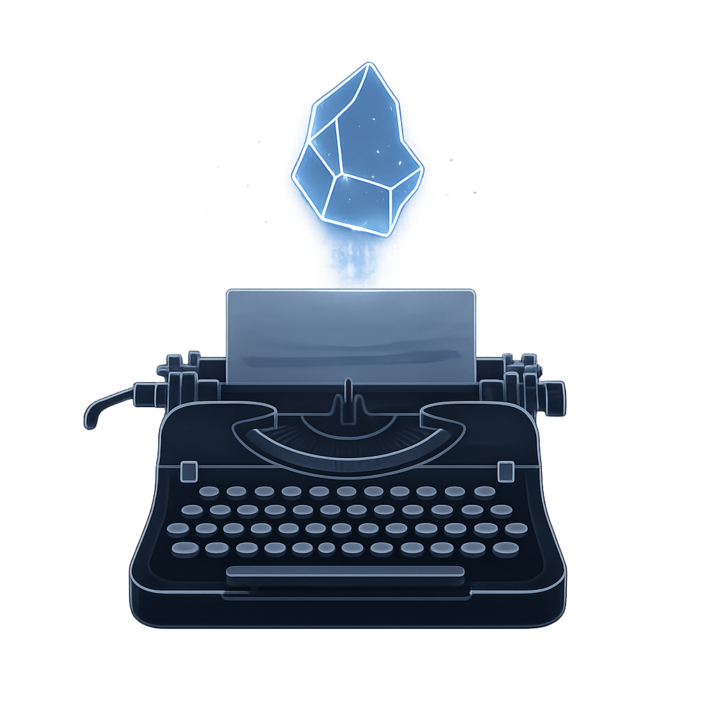
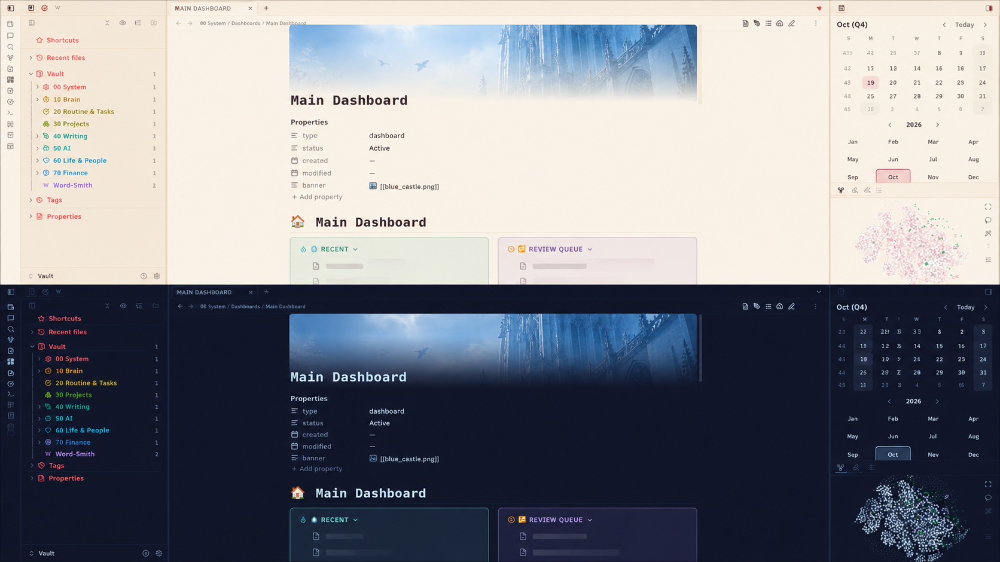

<h1 align="center">
  
<br><br>
Frostwriter
<br>

<br><br>
<em>"The best writing is cold"</em>
<br><br>

<div align="center">
<a href="https://obsidian.md" target="_blank">

</a>
<a href="https://github.com/AntonAbbac/Frostwriter/blob/main/LICENSE">

</a>
</div>
</h1>

---

## Gallery

<p align="center">
 <br>

Screenshot from <b>2026-10-19</b>
</p>

---

## So, what is this?

Frostwriter is the Obsidian vault I actually use, cleaned up enough to hand to someone else.

I wanted one place where I could write long things, keep a journal, jot down ideas, and keep track of what I'm working on, without spending half the day deciding where a note should go. This is what that turned into.

It's built around a few habits:

- **Long-form writing**, like manuscripts and anything that needs more than one sitting
- **Journaling**, with a daily, weekly and quarterly note that take a couple of minutes each
- **Atomic notes**, for ideas you want to keep and connect later
- **Plans and decisions**, so "what am I doing" and "why did I choose that" don't live only in your head

If you already know your way around Obsidian, you'll feel at home quickly. If you don't, it's still a decent place to learn, just expect to poke around a bit.

## How the vault is laid out

Nothing fancy, just numbered folders so they sort in a sensible order:

| Folder               | What goes there                                  |
| -------------------- | ------------------------------------------------ |
| `00 System`          | Templates and the vault's own housekeeping       |
| `10 Brain`           | Atomic notes, research, decisions                |
| `20 Routine & Tasks` | Work logs and day-to-day stuff                   |
| `30 Projects`        | Plans and projects                               |
| `40 Writing`         | The actual writing, plus the sources you lean on |
| `50 AI`              | Agent and prompt files                           |
| `60 Life & People`   | Daily/weekly/quarterly notes, events, people     |

Most notes are created from templates through QuickAdd, so you rarely have to create a file by hand.

## Plugins

### Core

Only the ones I actually leave on:

| Plugin                     | What it's doing here                               |
| -------------------------- | -------------------------------------------------- |
| Quick switcher             | Jumping between notes                              |
| Backlinks / Outgoing links | Seeing what connects to what                       |
| Command palette            | Running things without hunting through menus       |
| Editor status              | Small status info while writing                    |
| Outline                    | Navigating long notes by heading                   |
| Word count                 | Self-explanatory                                   |
| Workspaces                 | Saved layouts for daily review, planning and tasks |
| Bases                      | Database-style views of your notes                 |

### Community

| Plugin             | What it's for                                                                              | Repo                                                                                                |
| ------------------ | ------------------------------------------------------------------------------------------ | --------------------------------------------------------------------------------------------------- |
| QuickAdd           | Creating notes from templates and quick capture. This is what holds the workflow together. | [chhoumann/quickadd](https://github.com/chhoumann/quickadd)                                         |
| Workspaces Plus    | Switching layouts, which pairs with the core Workspaces plugin                             | [nothingislost/obsidian-workspaces-plus](https://github.com/nothingislost/obsidian-workspaces-plus) |
| Notebook Navigator | A nicer file browser                                                                       | [johansan/notebook-navigator](https://github.com/johansan/notebook-navigator)                       |
| Commander          | Putting your own commands in toolbars and menus                                            | [phibr0/obsidian-commander](https://github.com/phibr0/obsidian-commander)                           |
| StoryLine          | Planning and organizing long-form projects                                                 | [pixerojan/obsidian-storyline](https://github.com/pixerojan/obsidian-storyline)                     |
| Word-Smith         | Writing modes (zen, typewriter), word goals, export                                        | [Obsidian directory](https://community.obsidian.md/plugins/word-smith)                              |
| LanguageTool       | Grammar and spelling checks                                                                | [Clemens-E/obsidian-languagetool-plugin](https://github.com/Clemens-E/obsidian-languagetool-plugin) |
| Linter             | Keeps formatting and frontmatter consistent                                                | [platers/obsidian-linter](https://github.com/platers/obsidian-linter)                               |
| BeautyTasks        | Task management that doesn't look like a spreadsheet                                       | [avnibilgin/BeautyTasks](https://github.com/avnibilgin/BeautyTasks)                                 |
| Simple Banner      | Banner images at the top of notes                                                          | [eatcodeplay/obsidian-simple-banner](https://github.com/eatcodeplay/obsidian-simple-banner)         |
| Style Manager      | Tweaking the theme and CSS snippets from a settings pane                                   | [emarpiee/obsidian-style-manager](https://github.com/emarpiee/obsidian-style-manager)               |
| Penny Wallet       | Tracking expenses and income in plain Markdown                                             | [twrusstw/penny-wallet](https://github.com/twrusstw/penny-wallet)                                   |
| Smart Second Brain | Chatting with your own notes. Totally optional, and it needs Ollama or an OpenAI key.      | [your-papa/obsidian-Smart2Brain](https://github.com/your-papa/obsidian-Smart2Brain)                 |

Two small notes on privacy: LanguageTool sends your text to its server by default, so point it at a self-hosted one if that bothers you. Smart Second Brain keeps everything on your machine only if you run it with Ollama.

## Getting started

1. **Install Obsidian** from [obsidian.md/download](https://obsidian.md/download). It's on every platform you're likely to use.
2. **Clone the repo** (you'll need [Git](https://git-scm.com/downloads) installed):

   ```bash
   git clone https://github.com/AntonAbbac/Frostwriter.git
   ```

3. **Open the cloned folder as a vault** in Obsidian.
4. **Turn off Restricted mode** under Settings → Community plugins, enable the plugins you want, and reload.

To pick up changes later, run `git pull` inside the folder. Heads up: if you've edited files that I've also changed, Git will ask you to sort that out first.

If the QuickAdd menus come up empty, check that your template folder is set to `00 System/Templates`.

> [!NOTE]
> This is my personal setup, not a polished product. Change whatever doesn't fit you, and look over the settings before you rely on any of it.

Before you start, give the docs inside the vault a quick read. The home note links to all of them, and they explain how the pieces fit together. It'll save you some confusion later.

## Credits

Made by one person, for other people who like tinkering with their notes.

## License

MIT. See [LICENSE](./LICENSE) for the details.
